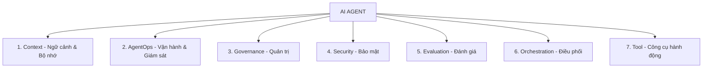

# Phân Tích Hạ Tầng AI Agent & Thiết Kế Bộ Nhớ (Memory/Context)

Sơ đồ bạn cung cấp mô tả **7 thành phần cốt lõi của một hệ sinh thái AI Agent hoàn chỉnh** (AI Agent Lifecycle/Infrastructure). Để hiện thực hóa mục tiêu "harnessing AI" (khai thác tối đa sức mạnh của AI) và xây dựng một AI có đủ **ngữ cảnh (Context)** cùng **bộ nhớ (Memory)** để thực hiện một dự án dài hơi, chúng ta cần phân tích sâu sơ đồ này và thiết lập hạ tầng tương ứng.

---

## 1. Phân Tích 7 Trụ Cột Trong Sơ Đồ



### 1.1. Context (Ngữ cảnh & Bộ nhớ)
* **Ý nghĩa**: Cung cấp cho Agent thông tin về "nó là ai", "nó đang làm việc với ai", "lịch sử đã làm gì" và "dữ liệu liên quan là gì".
* **Thành phần**:
  * **Short-term Memory**: Bộ nhớ ngắn hạn (lịch sử hội thoại hiện tại).
  * **Long-term Memory**: Bộ nhớ dài hạn (thông tin người dùng, kết quả các task cũ).
  * **Semantic Memory / RAG**: Tri thức ngoài (tài liệu dự án, codebase, API docs).

### 1.2. AgentOps (Vận hành & Giám sát)
* **Ý nghĩa**: Giúp bạn quan sát (observe) những gì đang xảy ra bên trong Agent.
* **Chức năng**: Ghi log chi tiết từng bước suy nghĩ (trace), đo lường độ trễ (latency), lượng token tiêu thụ và chi phí của từng request.
* **Công cụ phổ biến**: LangSmith, Phoenix (Arize), AgentOps.ai.

### 1.3. Governance (Quản trị)
* **Ý nghĩa**: Kiểm soát cách Agent hoạt động ở quy mô lớn.
* **Chức năng**: Giới hạn tần suất gọi API (rate limit), quản lý hạn mức chi phí (budget caps), ghi nhật ký kiểm toán (audit logs) và phân quyền truy cập.

### 1.4. Security (Bảo mật)
* **Ý nghĩa**: Đảm bảo Agent không bị khai thác hoặc làm rò rỉ dữ liệu nhạy cảm.
* **Chức năng**: Ngăn chặn Prompt Injection (tấn công thay đổi chỉ thị), lọc dữ liệu cá nhân nhạy cảm (PII Redaction), và kiểm soát an toàn đầu ra (output guardrails).
* **Công cụ**: NeMo Guardrails, Llama Guard.

### 1.5. Evaluation (Đánh giá)
* **Ý nghĩa**: Đo lường xem Agent hoạt động có chính xác và ổn định không.
* **Chức năng**: Chạy các tập test case tự động để đánh giá độ trung thực (groundedness), độ liên quan (relevance) và khả năng hoàn thành task của Agent.
* **Công cụ**: Ragas, DeepEval, TruLens.

### 1.6. Orchestration (Điều phối)
* **Ý nghĩa**: "Bộ não" quản lý luồng suy nghĩ và hành động của Agent.
* **Chức năng**: Lập kế hoạch (planning), chia nhỏ công việc (task decomposition), tự sửa lỗi (self-reflection) và điều phối nhiều Agent làm việc cùng nhau (Multi-Agent).
* **Công cụ**: LangGraph (rất mạnh cho luồng trạng thái phức tạp), CrewAI, Autogen.

### 1.7. Tool (Công cụ)
* **Ý nghĩa**: Cánh tay giúp AI tương tác với thế giới thực.
* **Chức năng**: Cho phép AI gọi API, truy vấn cơ sở dữ liệu, đọc/ghi file, thực thi mã code trong sandbox, hoặc tìm kiếm web.

---

## 2. Thiết Kế Hạ Tầng Bộ Nhớ & Ngữ Cảnh (Context & Memory)

Để AI có thể thực hiện một dự án phức tạp mà không bị "quên" hoặc "mất ngữ cảnh" sau vài lượt chat, chúng ta cần thiết kế hệ thống bộ nhớ phân tầng (Tiered Memory System):

```
┌────────────────────────────────────────────────────────────────────────┐
│                              AI AGENT                                  │
└───────────────────┬───────────────────┬───────────────────┬────────────┘
                    │                   │                   │
                    ▼                   ▼                   ▼
           [Short-term Memory]  [Long-term Memory]  [Semantic Knowledge]
           ┌─────────────────┐  ┌─────────────────┐ ┌──────────────────┐
           │ Lịch sử chat    │  │ Thực thể, Fact  │ │ Tài liệu dự án,  │
           │ gần nhất        │  │ sở thích user   │ │ code, tài liệu   │
           └────────┬────────┘  └────────┬────────┘ └────────┬─────────┘
                    │                    │                   │
                    ▼                    ▼                   ▼
               (Redis/Cache)     (Vector Database)     (Vector Database)
```

### Hướng tiếp cận chi tiết cho từng loại Memory:

1. **Short-term Memory (Bộ nhớ ngắn hạn - Session-based)**
   * **Cách lưu trữ**: Lưu trữ chuỗi các tin nhắn hội thoại gần nhất dưới dạng thô (Raw Chat History).
   * **Chiến lược tối ưu ngữ cảnh (Context window)**: Khi lịch sử quá dài, sử dụng phương pháp **Summarization** (tự động tóm tắt các đoạn hội thoại cũ và chỉ giữ lại bản tóm tắt + một vài tin nhắn mới nhất).
   * **Hạ tầng khuyến nghị**: **Redis** (dùng cấu trúc dữ liệu List để lưu lịch sử chat theo `session_id`).

2. **Long-term Memory (Bộ nhớ dài hạn - Profile/Fact-based)**
   * **Cách lưu trữ**: Khi hội thoại diễn ra, ta sử dụng một Agent phụ để "trích xuất sự kiện" (Extract Facts/Preferences).
     * *Ví dụ*: Người dùng nói "Dự án này viết bằng Next.js và dùng Prisma". Agent phụ sẽ lưu fact: `{"topic": "project_stack", "details": "Next.js, Prisma"}`.
   * **Hạ tầng khuyến nghị**: Một Vector Database hoặc cơ sở dữ liệu quan hệ (PostgreSQL) có hỗ trợ tìm kiếm ngữ nghĩa. Khi bắt đầu một session mới, Agent sẽ tìm các facts liên quan đến chủ đề hiện tại để nạp vào system prompt.

3. **Semantic Memory / RAG (Tri thức ngoài & Mã nguồn)**
   * **Cách lưu trữ**: Chunk codebase của bạn, tài liệu thiết kế hệ thống, tài liệu API thành các đoạn nhỏ (e.g., 500-1000 tokens), chuyển hóa thành vector bằng embedding model (như `text-embedding-3-small` của OpenAI), sau đó lưu vào Vector Database.
   * **Hạ tầng khuyến nghị**: **PostgreSQL với extension pgvector** (phù hợp nếu muốn tích hợp chung với DB quan hệ) hoặc **Qdrant / ChromaDB** (nếu muốn tối ưu hiệu năng tìm kiếm vector).

---

## 3. Đề Xuất Tech Stack Cho Hạ Tầng AI Agent Của Bạn

Nếu bạn muốn setup một hạ tầng mạnh mẽ, linh hoạt và sẵn sàng cho sản xuất (production-ready) trên máy local hoặc cloud, đây là cấu hình Stack tối ưu nhất hiện nay:

| Thành phần | Công nghệ lựa chọn | Lý do |
| :--- | :--- | :--- |
| **Orchestration** | **LangGraph** (Python hoặc TypeScript) | Quản lý luồng xử lý dạng đồ thị (State Graph), cho phép Agent lập vòng lặp (loop), tự sửa lỗi (reflection) và duy trì state cực tốt. |
| **Short-term Memory** | **Redis** | Tốc độ đọc/ghi cực nhanh, dễ dàng cấu hình time-to-live (TTL) cho session. |
| **Long-term & RAG** | **PostgreSQL (pgvector)** | Lưu trữ cả dữ liệu quan hệ (danh sách user, dự án) và dữ liệu vector trong cùng một DB, giảm thiểu độ phức tạp hạ tầng. |
| **AgentOps** | **LangSmith** hoặc **Arize Phoenix** | LangSmith tích hợp rất sâu với LangGraph/LangChain, giúp debug từng bước gọi LLM và Tool. |
| **Tools** | **Custom Tools + Sandbox** | Cho phép Agent tương tác trực tiếp với codebase, chạy test tự động, đọc file. |

---

## 4. Kế Hoạch Setup Hạ Tầng Từng Bước (Roadmap)

Dưới đây là các bước để bạn bắt đầu dựng hạ tầng này trong thư mục workspace `d:\StudioProjects\AI project`:

### Bước 1: Setup Môi Trường Docker
Tạo file `docker-compose.yml` để khởi chạy các dịch vụ cần thiết (PostgreSQL với pgvector, Redis, và giao diện quản lý).

### Bước 2: Khởi Tạo Dự Án Python/Node.js
Cài đặt các thư viện lõi: LangChain/LangGraph, thư viện kết nối cơ sở dữ liệu, và các SDK của LLM (OpenAI, Anthropic hoặc Google Gemini).

### Bước 3: Xây Dựng Pipeline RAG Cho Codebase
Viết một script để tự động quét thư mục dự án của bạn, chunk code và tài liệu, tạo embeddings và đẩy vào pgvector.

### Bước 4: Thiết Kế Agentic Workflow Với Memory
Viết mã nguồn điều phối (Orchestration) bằng LangGraph để Agent có thể:
1. Nhận câu hỏi từ user.
2. Truy vấn Redis để lấy lịch sử chat ngắn hạn.
3. Truy vấn PostgreSQL để lấy long-term memory & tài liệu RAG liên quan.
4. Lên kế hoạch giải quyết vấn đề và gọi các công cụ (Tools) nếu cần.
5. Cập nhật lại bộ nhớ dài hạn dựa trên kết quả mới.

---

*Bạn có muốn tôi bắt đầu khởi tạo cấu trúc thư mục dự án và file `docker-compose.yml` cho hệ thống cơ sở dữ liệu (PostgreSQL + pgvector + Redis) ngay tại workspace này không?*
